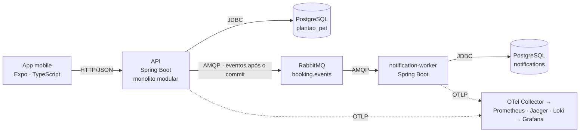

# Visão arquitetural — Plantão de Pet

Documento de entrada da arquitetura. Detalhes em: [C4](../c4/README.md) · [contratos de integração](contratos-integracao.md) · [ADRs](../adr/) · [diagramas](../c4/README.md#diagramas-complementares-docsdiagrams).

## 1. Problema e objetivos

O Plantão de Pet conecta **tutores de cães** a **cuidadores** (passeio, companhia, visita domiciliar, hospedagem e cuidado temporário). O tutor solicita uma reserva pelo app; o cuidador aceita ou rejeita; as mudanças geram notificações.

Objetivos arquiteturais, em ordem de prioridade:

1. **Consistência da reserva:** nenhuma reserva sobreposta para o mesmo cuidador e transições de status sempre válidas.
2. **Desacoplamento do que é lento ou falível:** notificações não podem atrasar nem derrubar a resposta ao usuário.
3. **Ownership claro dos dados:** cada componente é dono de um banco; integração só por contrato (REST ou evento).
4. **Observabilidade de ponta a ponta:** um trace único do app até o worker; métricas de negócio e de mensageria.
5. **Trabalho paralelo de 7 integrantes:** contratos antes da implementação, mocks e um ambiente que sobe com um comando.

## 2. Estilo: monolito modular + worker assíncrono

- **API** única (monolito modular, [ADR-001](../adr/ADR-001-estilo-arquitetural-backend.md)): o fluxo de reserva precisa de transação ACID local (verificação de sobreposição + gravação). Microsserviços trariam transação distribuída sem ganho para um time pequeno.
- **notification-worker** separado: é a única carga que se beneficia de isolamento (assíncrona, falível, com retry). É o mínimo de distribuição que demonstra mensageria e ownership de dados sem "criar microsserviços para dividir o trabalho".
- **Dois bancos com donos distintos:** a API é dona de `tutors`, `pets`, `caregivers`, `bookings`; o worker é dono de `processed_events` e `notifications`. Nenhum lê o banco do outro; o evento carrega os dados necessários. Consistência entre eles é **eventual**.

Detalhamento: [C1](../c4/C1-contexto.md) · [C2](../c4/C2-containers.md) · [C3 da API](../c4/C3-componentes-api.md) · [C3 do worker](../c4/C3-componentes-worker.md) · [deployment](../diagrams/deployment.md).

## 3. Decisões registradas

| ADR | Decisão | Área |
|---|---|---|
| [ADR-001](../adr/ADR-001-estilo-arquitetural-backend.md) | Monolito modular com workers assíncronos | Arquitetura |
| [ADR-002](../adr/ADR-002-stack-mobile.md) | React Native + Expo + TypeScript; API atrás da interface `PlantaoPetApi` (HTTP ou Mock) | Mobile |
| [ADR-003](../adr/ADR-003-persistencia.md) | PostgreSQL + Spring Data JPA + Flyway; ownership por componente | Dados |
| [ADR-004](../adr/ADR-004-mensageria.md) | RabbitMQ, exchange topic, DLQ, retry e consumidor idempotente | Mensageria |
| [ADR-005](../adr/ADR-005-observabilidade.md) | OpenTelemetry Java Agent → Collector → Prometheus, Jaeger, Loki → Grafana | Observabilidade |
| [ADR-006](../adr/ADR-006-containerizacao.md) | Docker Compose com profile `app`; Dockerfile Java único | Infraestrutura |
| [ADR-007](../adr/ADR-007-ci-cd.md) | GitHub Actions: `backend-ci`, `mobile-ci`, `docker-ci`, `docs-ci` | Qualidade |

Modelo de ADR: [ADR-000-layout.md](../adr/ADR-000-layout.md).

## 4. Padrões aplicados e onde estão

| Padrão | Problema que resolve | Onde no código |
|---|---|---|
| **Layered / Controller → Service → Domain → Repository** | Separar HTTP, regra de negócio e persistência | `services/api/.../api/{controller,service,domain,repository}` |
| **Repository** | Regra de negócio sem SQL; testes com mock | `api/repository/*Repository`, `notification/.../NotificationRepository`, `ProcessedEventRepository` |
| **Strategy** (preço) | Regra de preço diferente por `serviceType` sem condicional no serviço | `api/pricing/PriceStrategy` + 5 implementações (`WalkPriceStrategy` … `TemporaryCarePriceStrategy`) e `PriceCalculator` |
| **Strategy** (eventos) | Tratamento diferente por `eventType` no worker | handlers por tipo de evento em `br.pucminas.plantaopet.notification` |
| **Dependency Injection** | Baixo acoplamento e testabilidade | injeção por construtor em todos os beans Spring; `List<PriceStrategy>` injetada no `PriceCalculator`; `MeterRegistry` injetado |
| **Publish/Subscribe** | API não conhece consumidores | `api/messaging/BookingEventPublisher` → `RabbitBookingEventPublisher` → exchange `booking.events` (topic) |
| **Publicação após o commit** | Não emitir evento de reserva que sofreu rollback | `@TransactionalEventListener(phase = AFTER_COMMIT)` em `api/messaging/` |
| **Idempotent Consumer** | Entrega *at-least-once* sem notificação duplicada | serviço do worker + tabela `processed_events` (PK `event_id`) |
| **Retry + Dead Letter Channel** | Falha transitória vs. mensagem venenosa | política de retry do listener (3 tentativas) + `booking.events.dlx` / `notification.booking-events.dlq` |
| **Problem Details (RFC 7807)** | Contrato de erro único para o app | `api/exception/` (handler global) |
| **Adapter / interface de API no mobile** | App funciona sem backend | `PlantaoPetApi` com implementações HTTP e Mock, escolhidas pelo `ApiProvider` (`EXPO_PUBLIC_USE_MOCKS`) |

Fluxos dinâmicos: [sequência da reserva](../diagrams/sequencia-reserva.md) · [mensageria](../diagrams/mensageria.md) · [estados da reserva](../diagrams/estados-reserva.md).

## 5. Requisitos da disciplina → artefatos

| Requisito | Artefato no repositório |
|---|---|
| C4 níveis 1, 2 e 3 | [docs/c4/](../c4/README.md) (C1, C2, C3 da API e do worker) |
| Diagramas arquiteturais | [sequência](../diagrams/sequencia-reserva.md), [mensageria](../diagrams/mensageria.md), [deployment](../diagrams/deployment.md), [estados](../diagrams/estados-reserva.md), [DER](../diagrams/DER-inicial.md) |
| API / serviço | `services/api/`, contrato [openapi.yaml](../api/openapi.yaml) |
| Aplicação multiplataforma | `apps/mobile/` (Expo: Android, iOS e web) |
| Mensageria | [eventos.md](../api/eventos.md), [schema](../api/events/booking-event.schema.json), `api/messaging/`, `services/notification-worker/` |
| Banco de dados / ownership dos dados | [ADR-003](../adr/ADR-003-persistencia.md), [docs/database/](../database/README.md), migrations em `services/api/src/main/resources/db/migration/` e `services/notification-worker/src/main/resources/db/migration/` |
| Observabilidade | [ADR-005](../adr/ADR-005-observabilidade.md), [infrastructure/observability/](../../infrastructure/observability/README.md) (Collector, Prometheus, alertas, Loki, dashboard Grafana) |
| Design Patterns | seção 4 deste documento e [C3 da API](../c4/C3-componentes-api.md) |
| ADRs | [docs/adr/](../adr/) |
| Docker | [docker-compose.yml](../../docker-compose.yml), [java-service.dockerfile](../../infrastructure/docker/java-service.dockerfile), [guia](../../infrastructure/docker/README.md) |
| CI/CD | [.github/workflows/](../../.github/workflows/backend-ci.yml) (backend, mobile, docker, docs), [ADR-007](../adr/ADR-007-ci-cd.md), [template de PR](../../.github/pull_request_template.md) |
| Contratos antes da implementação | [contratos-integracao.md](contratos-integracao.md), OpenAPI, contrato de eventos, mocks do mobile com os IDs do seed |

## 6. Qualidade (CI)

Cada PR para `develop` ou `main` roda quatro workflows ([ADR-007](../adr/ADR-007-ci-cd.md)):

| Workflow | Verifica |
|---|---|
| [`backend-ci`](../../.github/workflows/backend-ci.yml) | `mvn -B verify` da API e do worker (JUnit, Mockito, Spring Boot Test), Java 21 |
| [`mobile-ci`](../../.github/workflows/mobile-ci.yml) | `npm ci`, tipos, lint e testes do app, Node 20 |
| [`docker-ci`](../../.github/workflows/docker-ci.yml) | build das imagens e `docker compose config` |
| [`docs-ci`](../../.github/workflows/docs-ci.yml) | links internos dos Markdown (lychee `--offline`) |

A branch protection exige esses checks verdes e revisão. A testabilidade decorre dos padrões: serviços dependem de interfaces (repositórios, `BookingEventPublisher`, `MeterRegistry`), então os testes unitários não precisam de banco nem de broker.

## 7. Observabilidade

| Pilar | Como | Onde ver |
|---|---|---|
| Traces | OTel Java Agent na imagem; contexto propagado por HTTP e por headers AMQP → um trace API → RabbitMQ → worker | Jaeger `http://localhost:16686` |
| Métricas | HTTP e JVM automáticas; negócio via Micrometer: `booking_created_total`, `booking_accepted_total`, `booking_rejected_total`, `booking_cancelled_total`, `message_processing_total{outcome}`, `message_processing_errors_total`; RabbitMQ e PostgreSQL por scrape | Prometheus `:9090`, dashboard Grafana `:3000` |
| Logs | SLF4J/Logback exportados por OTLP para o Loki, com `trace_id` | Grafana → Explore → Loki |
| Alertas | `TargetDown`, `ApiHighErrorRate`, `ApiHighLatencyP95`, `MessageProcessingErrors`, `RabbitMqQueueBacklog` | Prometheus `/alerts` |

## 8. Riscos e evoluções

- **Evento perdido se o broker cair logo após o commit** (sem *transactional outbox*). Mitigação no MVP: log de erro e métrica; evolução: outbox no banco da API.
- **Fronteiras de módulo por convenção**: evolução com ArchUnit ou Spring Modulith no CI.
- **Sem autenticação** no MVP: tutor e cuidador identificados por ID. Evolução: provedor de identidade, que entra como sistema externo no C1.
- **Pagamento e entrega real de notificações** fora do MVP: entram atrás de interfaces (gateway de pagamento na API, provedor de push/e-mail/SMS no worker), sem mudar o estilo arquitetural.
