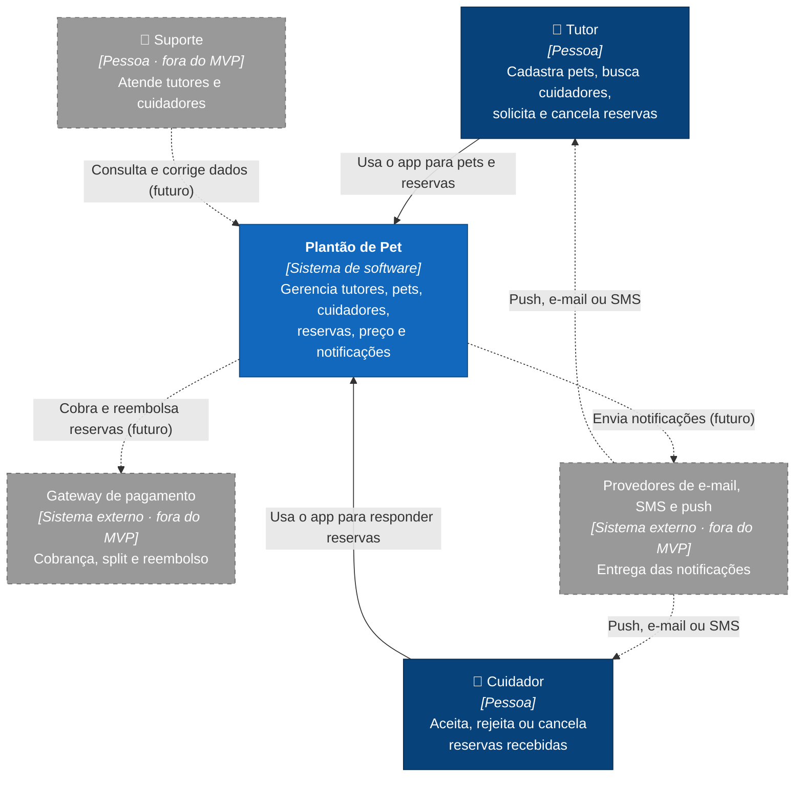

# C4 · Nível 1 — Contexto do sistema

> Índice do C4: [README](README.md) · Próximo nível: [C2 — Containers](C2-containers.md)

## Objetivo

Mostrar **quem usa** o Plantão de Pet e **com quais sistemas externos** ele se relaciona, sem detalhes de tecnologia.

O Plantão de Pet é um marketplace que conecta **tutores de cães** a **cuidadores** que oferecem passeio, companhia, visita domiciliar, hospedagem e cuidado temporário. O tutor solicita uma reserva; o cuidador aceita ou rejeita; ambos são notificados das mudanças.

## Diagrama

Legenda: azul-escuro = pessoa; azul = o sistema; cinza tracejado = **fora do MVP** (previsto, não implementado).

## Elementos

| Elemento | Tipo | Responsabilidade | No MVP? |
|---|---|---|---|
| Tutor | Pessoa | Dono do cão. Cadastra pets, consulta cuidadores, solicita, acompanha e cancela reservas | Sim |
| Cuidador | Pessoa | Presta o serviço. Aceita, rejeita ou cancela reservas | Sim |
| Suporte | Pessoa | Atendimento e correção de dados | Não |
| Plantão de Pet | Sistema | Regras de reserva, cálculo de preço, persistência e notificações | Sim |
| Gateway de pagamento | Sistema externo | Cobrança no app, split e reembolso | Não |
| Provedores de e-mail/SMS/push | Sistema externo | Entrega real das notificações | Não |

## Decisões de escopo refletidas no diagrama

- **Notificações no MVP:** o sistema **gera e registra** as notificações (banco do `notification-worker`), mas não as entrega por um provedor externo. A troca do registro por um provedor real fica atrás de uma interface no worker e não muda este nível.
- **Pagamento no MVP:** o preço é calculado e gravado na reserva (`priceCents`), mas não há cobrança. O ciclo de estados do MVP não tem `PAID` (ver [estados da reserva](../diagrams/estados-reserva.md)).
- **Identidade:** não há autenticação no MVP; tutor e cuidador são identificados pelos IDs de demonstração do seed ([contratos de integração](../architecture/contratos-integracao.md)).

## Versão em imagem

A primeira versão do C1, elaborada pelo responsável pela arquitetura, está em imagem:

O diagrama Mermaid acima é a versão **mantida junto ao código** (revisável por Pull Request). Se houver divergência, vale o Mermaid, e a imagem deve ser regerada.
