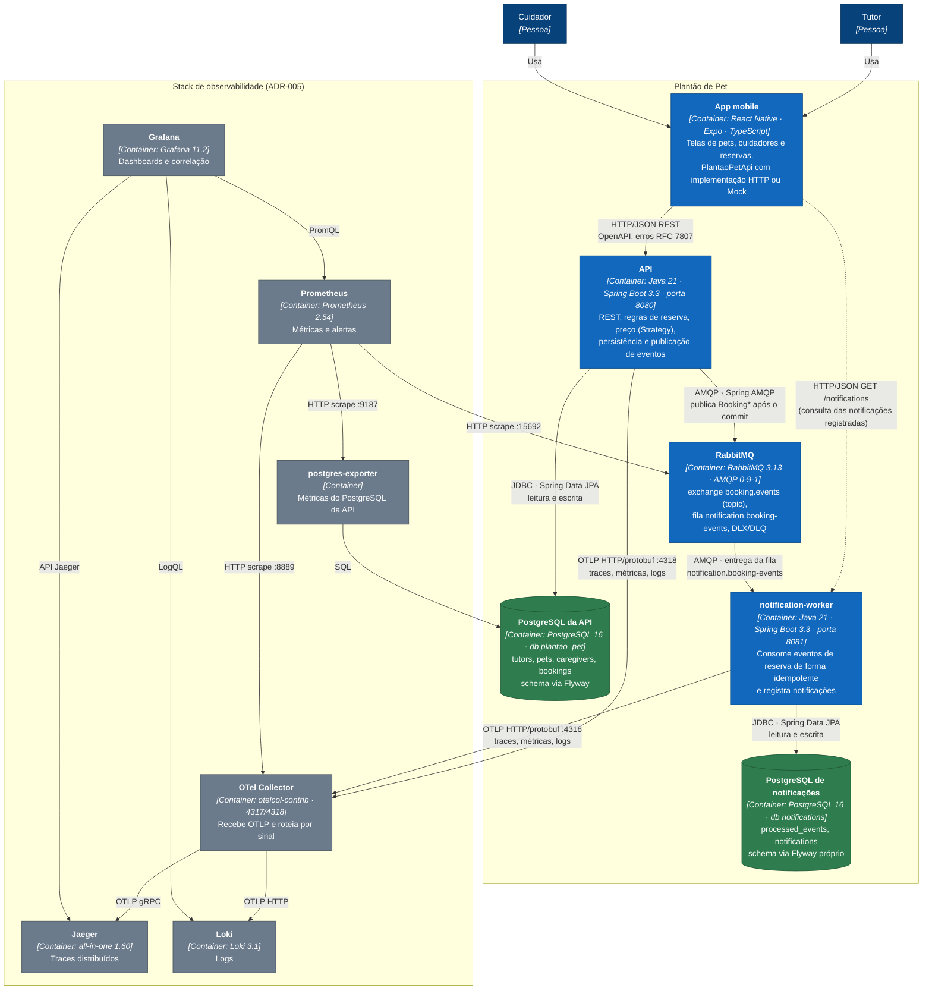

# C4 · Nível 2 — Containers

> Índice do C4: [README](README.md) · Anterior: [C1 — Contexto](C1-contexto.md) · Próximos: [C3 — API](C3-componentes-api.md), [C3 — Worker](C3-componentes-worker.md)

## Objetivo

Abrir o sistema Plantão de Pet nas **unidades executáveis e de dados** (containers no sentido do C4), com a tecnologia de cada uma e o protocolo de cada comunicação. Os containers do backend correspondem 1:1 aos serviços do [`docker-compose.yml`](../../docker-compose.yml) (ADR-006); a implantação física está no [diagrama de deployment](../diagrams/deployment.md).

## Diagrama



Legenda: azul = container da aplicação; verde = banco de dados; cinza = observabilidade. Seta tracejada = uso secundário.

## Containers

| Container | Tecnologia | Responsabilidade | Código / configuração |
|---|---|---|---|
| App mobile | React Native, Expo, TypeScript | Interface do tutor e do cuidador; alterna HTTP/Mock por `EXPO_PUBLIC_USE_MOCKS` | `apps/mobile/` |
| API | Java 21, Spring Boot 3.3, Spring Web, Spring Data JPA, Spring AMQP | Contrato REST ([OpenAPI](../api/openapi.yaml)), regras de negócio, preço, publicação de eventos | `services/api/` |
| PostgreSQL da API | PostgreSQL 16 | Dados do domínio de reservas | migrations em `services/api/src/main/resources/db/migration/` |
| RabbitMQ | RabbitMQ 3.13 (management + prometheus) | Transporte assíncrono dos eventos ([contrato de eventos](../api/eventos.md)) | `infrastructure/docker/rabbitmq/` |
| notification-worker | Java 21, Spring Boot 3.3, Spring AMQP, Spring Data JPA | Consumo idempotente, retry, DLQ, registro de notificações | `services/notification-worker/` |
| PostgreSQL de notificações | PostgreSQL 16 | Idempotência e notificações | migrations em `services/notification-worker/src/main/resources/db/migration/` |
| OTel Collector, Prometheus, Jaeger, Loki, Grafana, postgres-exporter | ver ADR-005 | Logs, métricas, traces, dashboards e alertas | [`infrastructure/observability/`](../../infrastructure/observability/README.md) |

## Ownership dos dados

```text
API ─────────────▶ PostgreSQL da API (plantao_pet)       dono: API
notification-worker ▶ PostgreSQL de notificações         dono: worker
API ──evento──▶ RabbitMQ ──▶ notification-worker         único caminho entre os dois
```

- Cada banco tem **um único dono** e um Flyway próprio. Nenhum container lê ou escreve no banco do outro ([ADR-003](../adr/ADR-003-persistencia.md), [contratos](../architecture/contratos-integracao.md#ownership-dos-dados)).
- O worker recebe **tudo** de que precisa no evento (`data` do envelope). Ele não chama a API nem lê `bookings`.
- Essa separação é a estratégia de "dados distribuídos / ownership" do projeto: os bancos são independentes e a consistência entre eles é **eventual**, via eventos.

## Decisões refletidas

| Decisão | ADR |
|---|---|
| Monolito modular (API) + worker assíncrono, sem microsserviços | [ADR-001](../adr/ADR-001-estilo-arquitetural-backend.md) |
| Stack mobile Expo/React Native | [ADR-002](../adr/ADR-002-stack-mobile.md) |
| PostgreSQL + JPA + Flyway, ownership por banco | [ADR-003](../adr/ADR-003-persistencia.md) |
| RabbitMQ, topic exchange, DLQ, idempotência | [ADR-004](../adr/ADR-004-mensageria.md) |
| OpenTelemetry → Collector → Prometheus/Jaeger/Loki → Grafana | [ADR-005](../adr/ADR-005-observabilidade.md) |
| Docker Compose, profile `app` | [ADR-006](../adr/ADR-006-containerizacao.md) |
