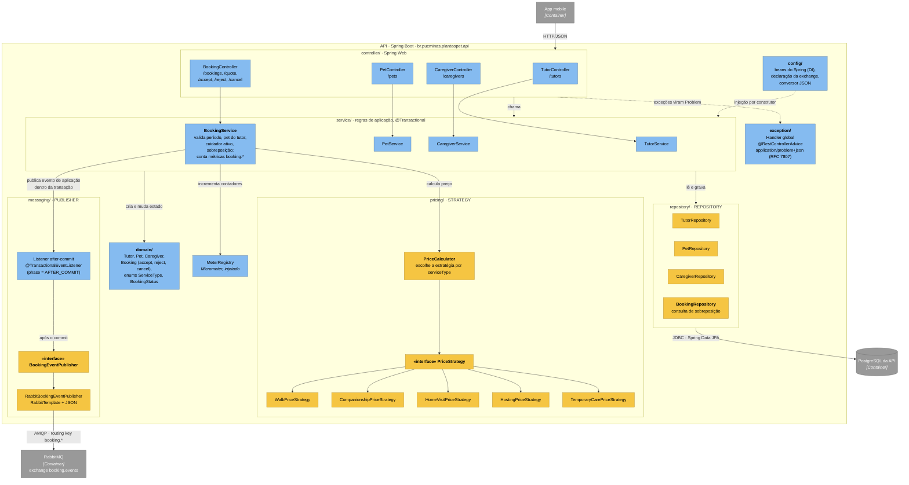

# C4 · Nível 3 — Componentes da API

> Índice do C4: [README](README.md) · Container de origem: [C2 — API](C2-containers.md) · Ver também: [C3 — Worker](C3-componentes-worker.md)

## Objetivo

Mostrar a organização interna do container **API** (`services/api`, pacote `br.pucminas.plantaopet.api`) e onde ficam os padrões de projeto exigidos: **Repository**, **Strategy**, **Dependency Injection** e **Publisher** (Publish/Subscribe).

Fluxo de dependência: `controller → service → domain / pricing / repository / messaging`. O domínio não depende de Spring Web nem de RabbitMQ; as entidades usam apenas o mapeamento JPA (ADR-001, ADR-003).

## Diagrama

Legenda: amarelo = componentes que materializam um padrão de projeto exigido; azul-claro = demais componentes; cinza = containers vizinhos.

## Componentes

| Componente | Pacote | Responsabilidade |
|---|---|---|
| Controllers | `controller/` | Mapeiam o [OpenAPI](../api/openapi.yaml) para chamadas de serviço; validam o formato da entrada (Bean Validation); não têm regra de negócio |
| Handler de erros | `exception/` | Converte exceções de domínio em `application/problem+json` com 400, 404, 409 e 422 |
| Services | `service/` | Orquestram o caso de uso em uma transação; aplicam as regras da reserva ([contratos](../architecture/contratos-integracao.md#regras-de-negócio-da-reserva)) |
| Domínio | `domain/` | Entidades e invariantes; `Booking` concentra as transições de status ([estados](../diagrams/estados-reserva.md)) |
| Preço | `pricing/` | Uma estratégia por `serviceType`, escolhida pelo `PriceCalculator`; usado em `POST /bookings` e `GET /bookings/quote` |
| Repositories | `repository/` | Interfaces Spring Data JPA; único ponto de acesso ao PostgreSQL |
| Mensageria | `messaging/` | Publica o envelope de evento ([contrato](../api/eventos.md)) somente após o commit |
| Configuração | `config/` | Beans e topologia AMQP do lado publicador |

## Onde está cada padrão

| Padrão | Componente | Por que existe aqui |
|---|---|---|
| **Repository** | `repository/*Repository` | O `BookingService` depende de uma interface, não de SQL nem do PostgreSQL. Nos testes de serviço, o repositório é substituído por mock (Mockito) |
| **Strategy** | `pricing/PriceStrategy` + 5 implementações + `PriceCalculator` | Cada tipo de serviço tem regra de preço diferente (hora, dia de calendário, diária). Novo serviço = nova estratégia, sem `if/switch` no `BookingService` (aberto/fechado) |
| **Dependency Injection** | Todos os `@Service`, `@Component` e `@Repository` | Injeção por construtor feita pelo Spring. O `PriceCalculator` recebe `List<PriceStrategy>`, então as estratégias são descobertas sem registro manual; `MeterRegistry` (e um `Clock`, se adotado) também são injetados, o que permite testes determinísticos |
| **Publisher / Publish-Subscribe** | `messaging/BookingEventPublisher` + `RabbitBookingEventPublisher` | O serviço não conhece o RabbitMQ: depende da interface. A publicação ocorre no `AFTER_COMMIT`, então nenhum evento é emitido para uma reserva que sofreu rollback |
| **Problem Details** | `exception/` | Contrato de erro único para o mobile (RFC 7807) |

## Fluxo de `POST /bookings` dentro da API

1. `BookingController` recebe o JSON e delega ao `BookingService`.
2. `BookingService` valida período, dono do pet, cuidador ativo e sobreposição (`BookingRepository`).
3. `PriceCalculator` escolhe a `PriceStrategy` pelo `serviceType` e calcula `priceCents`.
4. `Booking` é criado em `REQUESTED` e salvo; o contador `booking.created` é incrementado.
5. O serviço emite um evento de aplicação; após o commit, o listener chama `BookingEventPublisher`, que envia `BookingCreated` para `booking.events`.

Sequência completa, com caminhos alternativos: [sequencia-reserva.md](../diagrams/sequencia-reserva.md).

## Limites conhecidos

- **Publicação após o commit sem outbox:** se o RabbitMQ estiver fora no instante da publicação, a reserva fica gravada e o evento é perdido (registrado em log de erro). Um *transactional outbox* resolveria, mas está fora do MVP; a escolha deve constar do [ADR-004](../adr/ADR-004-mensageria.md).
- **Fronteiras de módulo** são garantidas por convenção de pacotes; a verificação automática (ArchUnit ou Spring Modulith) é evolução prevista no [ADR-007](../adr/ADR-007-ci-cd.md).
- Os nomes de classes acima seguem a estrutura combinada para a implementação. Se a implementação renomear uma classe, atualize este diagrama no mesmo Pull Request.
