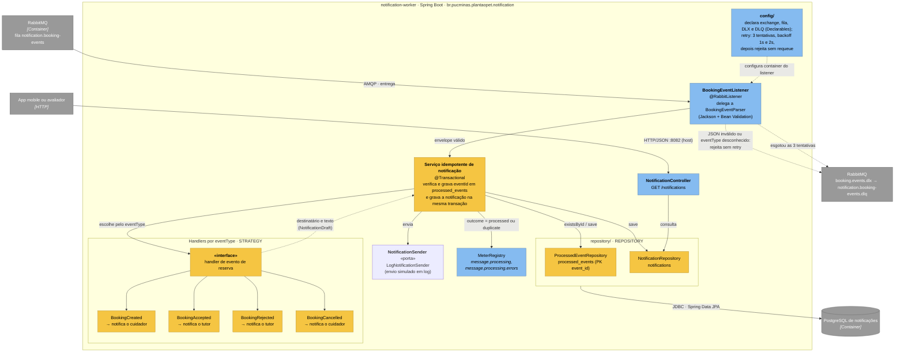

# C4 · Nível 3 — Componentes do notification-worker

> Índice do C4: [README](README.md) · Container de origem: [C2 — notification-worker](C2-containers.md) · Ver também: [C3 — API](C3-componentes-api.md)

## Objetivo

Mostrar a organização interna do container **notification-worker** (`services/notification-worker`, pacote `br.pucminas.plantaopet.notification`) e onde ficam os padrões de mensageria: **Idempotent Consumer**, **Dead Letter Channel**, **retry** e **Strategy** por tipo de evento.

O worker é dono do próprio banco (`notifications`) e não acessa o banco da API (ADR-003). Tudo o que ele precisa chega no envelope do evento ([contrato de eventos](../api/eventos.md)).

## Diagrama

Legenda: amarelo = padrões de projeto ou de integração; azul-claro = demais componentes; cinza = elementos externos ao worker.

## Componentes

| Componente | Responsabilidade |
|---|---|
| `config/` | Declara a topologia do lado consumidor (idempotente: API e worker declaram a exchange), e a política de retry do listener (interceptor em código para não retentar `AmqpRejectAndDontRequeueException`) |
| `BookingEventListener` | Ponto de entrada AMQP; converte a mensagem no envelope (`eventId`, `eventType`, `version`, `occurredAt`, `data`) |
| Serviço idempotente | Em uma transação: se `eventId` já está em `processed_events`, confirma e ignora (`duplicate`); senão, chama o handler, grava a notificação e o `eventId` (`processed`) |
| Handlers por `eventType` | Um por evento; só definem destinatário e texto (`NotificationDraft`); quem grava é o serviço. Novo evento = novo handler |
| `NotificationSender` | Porta de saída do envio; hoje `LogNotificationSender` (simulado). Trocar por e-mail/push não muda o serviço |
| `ProcessedEventRepository` / `NotificationRepository` | Spring Data JPA sobre o banco `notifications` (Flyway em `services/notification-worker/src/main/resources/db/migration/`) |
| `NotificationController` | `GET /notifications` para consultar o que foi registrado (demonstração da entrega) |

## Onde está cada padrão

| Padrão | Onde | Efeito |
|---|---|---|
| **Idempotent Consumer** | Serviço idempotente + `processed_events` (chave primária `event_id`) | Mensagem repetida (redelivery, publicação duplicada) não gera segunda notificação. A chave primária protege também contra duas entregas simultâneas: a segunda transação falha na inserção e é tratada como duplicada |
| **Dead Letter Channel** | `x-dead-letter-exchange=booking.events.dlx` na fila + DLQ | Mensagens que não podem ser processadas saem da fila principal sem travar as demais e ficam disponíveis para análise |
| **Retry com backoff** | Política do listener em `config/` | Falhas transitórias (ex.: banco do worker indisponível) são retentadas 3 vezes no total, com espera de 1s e 2s |
| **Strategy** | Handlers por `eventType` | O listener e o serviço não têm `switch` por tipo de evento |
| **Repository** e **DI** | `repository/`, injeção por construtor | Serviço testável com mocks, sem RabbitMQ nem PostgreSQL |

Ciclo de vida completo da mensagem: [mensageria.md](../diagrams/mensageria.md).

## Limites conhecidos

- No MVP, "notificar" significa **registrar** a notificação no banco do worker. A entrega real (push, e-mail, SMS) entrará como mais uma implementação atrás de uma interface, sem mudar o restante do worker (C1: provedores fora do MVP).
- O endpoint `GET /notifications` do worker ainda não está descrito no [OpenAPI](../api/openapi.yaml), que cobre apenas a API.
- O reprocessamento da DLQ é manual (painel do RabbitMQ em `http://localhost:15672`).
