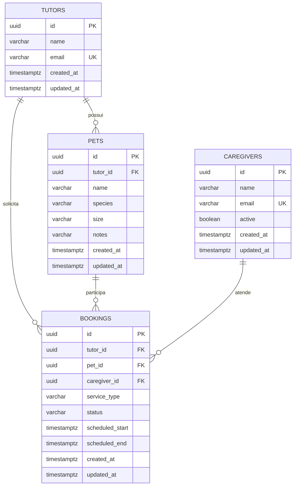

# DER inicial — PetAmparo

> Proposta para revisão junto ao responsável pelo backend antes de ser considerada contrato definitivo.

## Observações

- `Booking` mantém referências explícitas para tutor, pet e cuidador para refletir o fluxo atualmente documentado.
- A migration protege o período com `scheduled_end > scheduled_start`.
- A consistência entre `bookings.tutor_id` e o tutor proprietário de `bookings.pet_id` ainda está marcada como ponto de decisão arquitetural/modelagem.
- O diagrama representa o modelo lógico proposto; regras de negócio de transição entre status pertencem ao domínio da aplicação.
