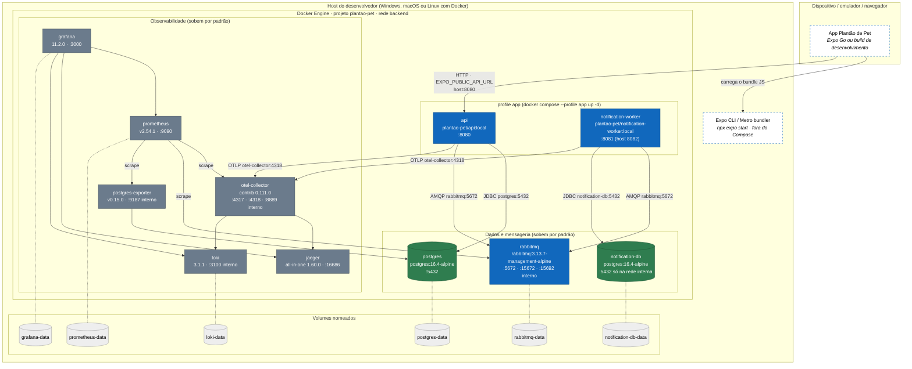

# Deployment — ambiente local (Docker Compose)

Decisão: [ADR-006](../adr/ADR-006-containerizacao.md) · Arquivo: [`docker-compose.yml`](../../docker-compose.yml) · Guia: [infrastructure/docker](../../infrastructure/docker/README.md) · Visão lógica: [C2](../c4/C2-containers.md).

Projeto Compose `plantao-pet`, rede bridge única `backend`. O mobile **não** roda no Compose: o Expo roda no host do desenvolvedor e o app abre em emulador, navegador ou dispositivo físico.

## Diagrama



Dentro da rede `backend`, os containers se encontram pelo **nome do serviço** (`postgres`, `rabbitmq`, `otel-collector`...). As portas publicadas abaixo são as que o host (e o celular) enxergam.

## Portas publicadas no host

Todas configuráveis no `.env` (ver `.env.example`).

| Serviço | Porta no host | Variável | Uso |
|---|---|---|---|
| api | 8080 | `API_PORT` | REST para o mobile; `/actuator/health` |
| notification-worker | 8082 (→ 8081 no container) | `WORKER_PORT` | `GET /notifications`; `/actuator/health` |
| postgres | 5432 | `DB_PORT` | acesso local ao banco da API (desenvolvimento) |
| rabbitmq | 5672 · 15672 | `RABBITMQ_PORT` · `RABBITMQ_MANAGEMENT_PORT` | AMQP · painel de gestão |
| otel-collector | 4317 · 4318 | `OTLP_GRPC_PORT` · `OTLP_HTTP_PORT` | OTLP para serviços rodando fora do Compose |
| prometheus | 9090 | `PROMETHEUS_PORT` | consultas e alertas |
| jaeger | 16686 | `JAEGER_PORT` | interface de traces |
| grafana | 3000 | `GRAFANA_PORT` | dashboards |

Somente na rede interna (sem porta no host): `notification-db` (5432), `loki` (3100), `postgres-exporter` (9187), métricas do RabbitMQ (15692) e do Collector (8888/8889).

## Profiles e ordem de subida

| Comando | Sobe |
|---|---|
| `docker compose up -d` | postgres, notification-db, rabbitmq e toda a observabilidade |
| `docker compose --profile app up -d` | o anterior + `api` e `notification-worker` (imagens a partir de `infrastructure/docker/java-service.dockerfile`) |

- `api` espera `postgres` e `rabbitmq` saudáveis (healthcheck) e o `otel-collector` iniciado.
- `notification-worker` espera `notification-db` e `rabbitmq` saudáveis e o `otel-collector` iniciado; não depende de `postgres` (ownership, ADR-003).
- O Flyway de cada serviço migra o próprio banco na inicialização.

## Mobile fora do Compose

```bash
cd apps/mobile
npx expo start
```

- `EXPO_PUBLIC_API_URL` padrão `http://localhost:8080` funciona no navegador e no simulador iOS. No emulador Android use `http://10.0.2.2:8080`; em dispositivo físico, o IP do host na rede local (`http://192.168.x.y:8080`).
- `EXPO_PUBLIC_USE_MOCKS=true` dispensa o backend (implementação Mock da `PlantaoPetApi`).
- O Metro do Expo usa a porta **8081** do host; por isso o `notification-worker` é publicado na **8082** (internamente continua 8081).

## Fora do escopo

Não há ambiente de nuvem nem deploy automatizado (CD); o ADR-007 limita o pipeline a CI. Se um ambiente remoto for definido, este diagrama ganha um segundo nó de implantação e o ADR correspondente.
