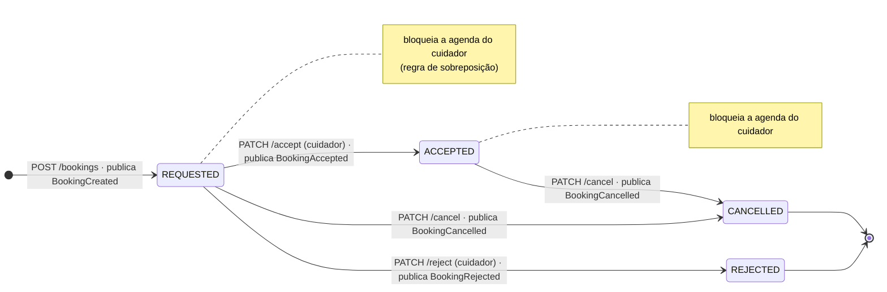

# Estados da reserva (`Booking`)

Fonte: [contratos de integração — regras de negócio](../architecture/contratos-integracao.md#regras-de-negócio-da-reserva). As transições são métodos da entidade `Booking` (`domain/`, ver [C3 da API](../c4/C3-componentes-api.md)); qualquer outra transição responde **409** (`application/problem+json`).

| De | Ação | Para | Evento | Bloqueia agenda / resultado |
|---|---|---|---|---|
| — | `POST /bookings` | `REQUESTED` | `BookingCreated` | sim |
| `REQUESTED` | `PATCH /bookings/{id}/accept` | `ACCEPTED` | `BookingAccepted` | sim |
| `REQUESTED` | `PATCH /bookings/{id}/reject` | `REJECTED` | `BookingRejected` (com `reason` opcional) | não |
| `REQUESTED` | `PATCH /bookings/{id}/cancel` | `CANCELLED` | `BookingCancelled` (com `reason` opcional) | não |
| `ACCEPTED` | `PATCH /bookings/{id}/cancel` | `CANCELLED` | `BookingCancelled` (com `reason` opcional) | não |
| `REJECTED`, `CANCELLED` | qualquer | — | nenhum | 409 (estado final) |
| `ACCEPTED` | accept ou reject | — | nenhum | 409 |

Regras:

- Somente `REQUESTED` e `ACCEPTED` contam para a verificação de sobreposição de horário do cuidador (409 na criação).
- O evento de cada transição é publicado **após o commit** ([mensageria](mensageria.md)).
- `REJECTED` e `CANCELLED` são finais no MVP.

## Estados fora do MVP

O [ADR-001](../adr/ADR-001-estilo-arquitetural-backend.md) e o [modelo lógico](../database/modelo-logico-inicial.md) citam um ciclo mais amplo (`PAID`, `IN_PROGRESS`, `COMPLETED`, `EXPIRED`), ligado a pagamento e execução do serviço. Eles **não** fazem parte do contrato atual. Se entrarem, exigem atualização deste diagrama, do OpenAPI, do contrato de eventos e do C1 (gateway de pagamento).
