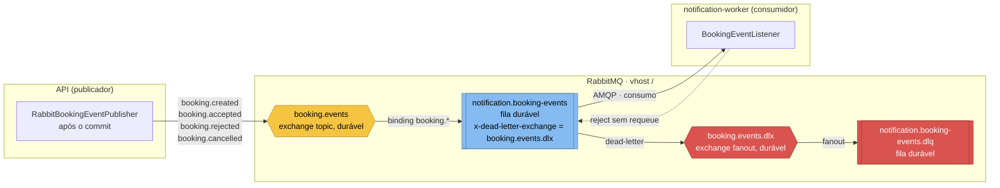
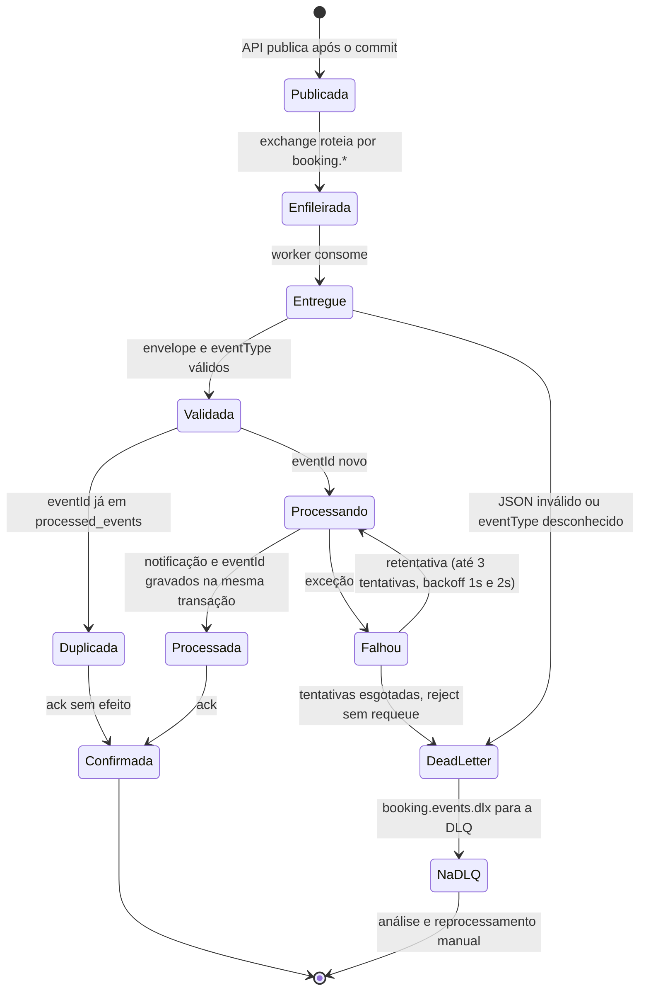

# Mensageria — topologia e ciclo de vida da mensagem

Decisão: [ADR-004](../adr/ADR-004-mensageria.md) · Contrato: [eventos.md](../api/eventos.md) · Schema: [booking-event.schema.json](../api/events/booking-event.schema.json) · Componentes do consumidor: [C3 do worker](../c4/C3-componentes-worker.md).

## Topologia RabbitMQ



| Elemento | Nome | Declarado por |
|---|---|---|
| Exchange | `booking.events` (topic, durável) | API e worker (declaração idempotente) |
| Routing keys | `booking.created`, `booking.accepted`, `booking.rejected`, `booking.cancelled` | API |
| Fila | `notification.booking-events` (durável, binding `booking.*`) | worker |
| Dead-letter exchange | `booking.events.dlx` (fanout, durável) | worker |
| Dead-letter queue | `notification.booking-events.dlq` (durável) | worker |

Por que **topic**: um novo consumidor (ex.: um futuro serviço de avaliações interessado só em `booking.accepted`) cria a própria fila com o binding que quiser, sem alterar a API. A API publica sem saber quem consome (Publish/Subscribe).

## Envelope

```text
eventId     UUID novo por evento — chave de idempotência
eventType   BookingCreated | BookingAccepted | BookingRejected | BookingCancelled
version     1 — muda só em alteração incompatível de data
occurredAt  instante UTC
data        bookingId, tutorId, petId, caregiverId, serviceType, status,
            scheduledStart, scheduledEnd, priceCents, reason
```

Mensagem persistente, `content-type: application/json`. O worker não consulta a API: `data` é autossuficiente (ADR-003).

## Ciclo de vida da mensagem



| Situação | Resultado | Métrica (Prometheus) |
|---|---|---|
| Evento novo processado | ack, notificação gravada | `message_processing_total{outcome="processed"}` |
| Evento repetido | ack, nada gravado | `message_processing_total{outcome="duplicate"}` |
| Falha transitória que se recupera | ack após nova tentativa | — |
| Falha persistente | DLQ após 3 tentativas | `message_processing_errors_total` |
| Mensagem inválida | DLQ direto | `message_processing_errors_total` |
| Fila acumulando | — | alerta `RabbitMqQueueBacklog` |

## Garantias e limites

- **Entrega:** *at-least-once* do broker para o worker (ack só após o commit no banco do worker). A idempotência por `eventId` transforma isso em efeito *exactly-once* na notificação.
- **Publicação:** acontece **após o commit** (`@TransactionalEventListener(phase = AFTER_COMMIT)`). Nunca há evento de reserva que não existe; porém, se o broker estiver fora no instante da publicação, o evento se perde (sem *transactional outbox* no MVP).
- **Ordem:** uma única fila e um consumidor preservam a ordem na prática; o worker não depende dela, porque cada evento carrega o `status` resultante.
- **Rastreio:** o contexto OpenTelemetry viaja nos headers AMQP; publicação e consumo aparecem no mesmo trace.

Visão em sequência dos caminhos de duplicidade e falha: [sequencia-reserva.md](sequencia-reserva.md#3-caminhos-alternativos).
