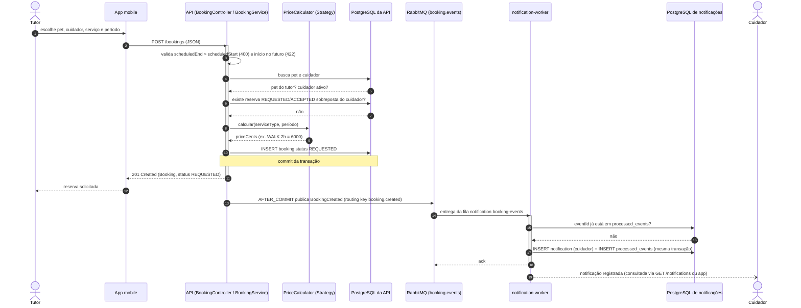
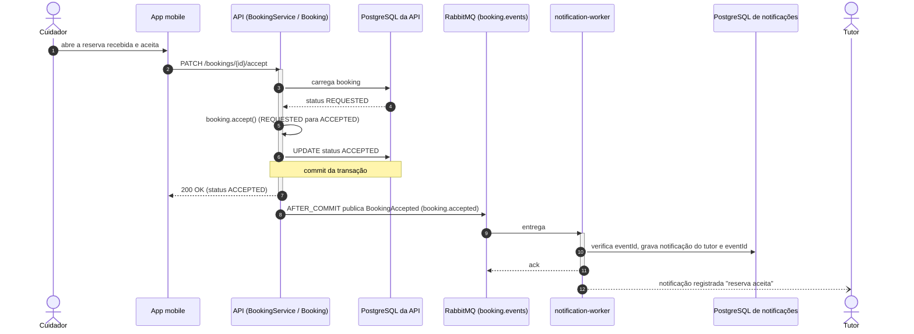
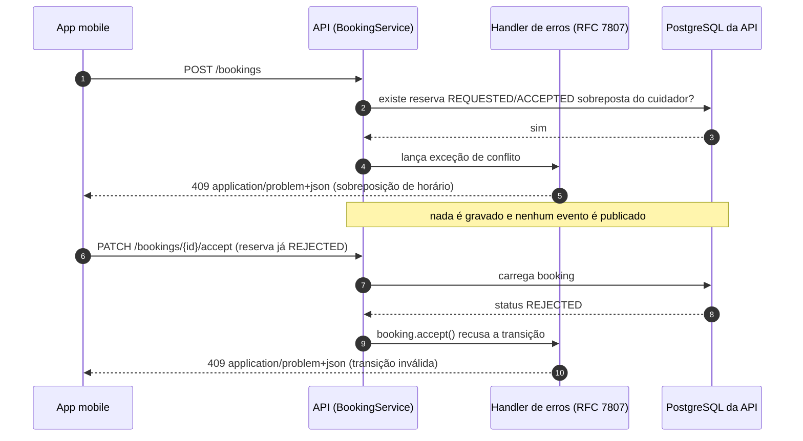
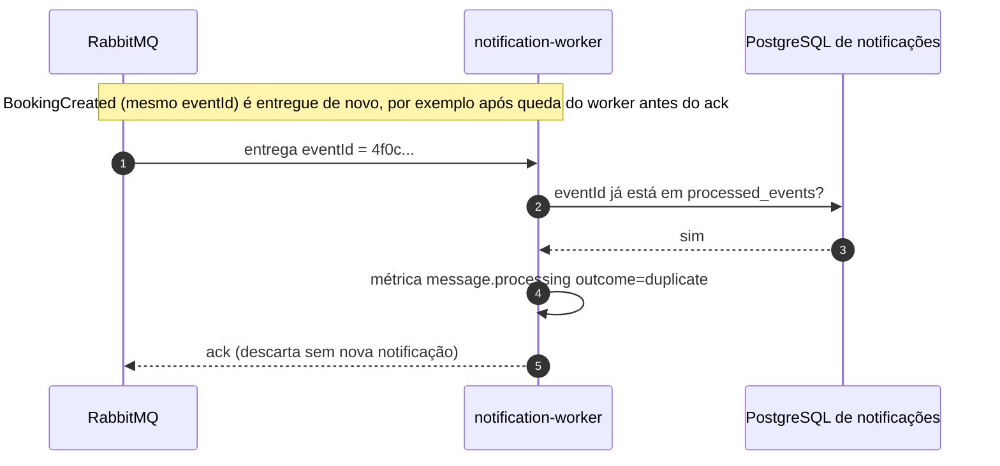
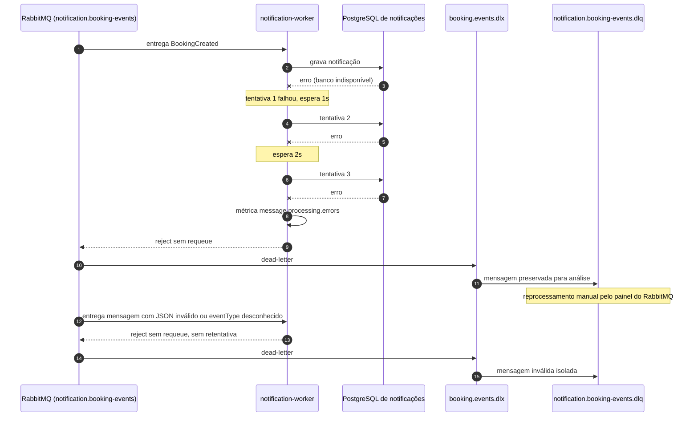

# Sequência — ciclo da reserva

Fluxo principal do projeto: o tutor solicita uma reserva, o cuidador é notificado, aceita, e o tutor é notificado. Componentes: [C3 da API](../c4/C3-componentes-api.md) e [C3 do worker](../c4/C3-componentes-worker.md). Contratos: [OpenAPI](../api/openapi.yaml), [eventos](../api/eventos.md), [regras de negócio](../architecture/contratos-integracao.md#regras-de-negócio-da-reserva).

## 1. Criação da reserva e notificação do cuidador

## 2. Aceite pelo cuidador e notificação do tutor

Rejeição (`PATCH /bookings/{id}/reject`, evento `BookingRejected`) e cancelamento (`PATCH /bookings/{id}/cancel`, evento `BookingCancelled`) seguem a mesma sequência, com `reason` opcional no evento.

## 3. Caminhos alternativos

### 3.1 Conflito de agenda (409) e transição inválida (409)

Outras respostas de erro da criação: 400 (período invertido), 404 (cuidador inexistente), 422 (início no passado, pet de outro tutor, cuidador inativo).

### 3.2 Mensagem duplicada (Idempotent Consumer)

### 3.3 Falha no processamento: retry e DLQ

## Rastreabilidade

O OpenTelemetry Java Agent propaga o contexto de trace pelos headers AMQP, então os passos da API e do worker aparecem em **um único trace** no Jaeger (`http://localhost:16686`), e os logs carregam o mesmo `trace_id` no Loki ([ADR-005](../adr/ADR-005-observabilidade.md)).
